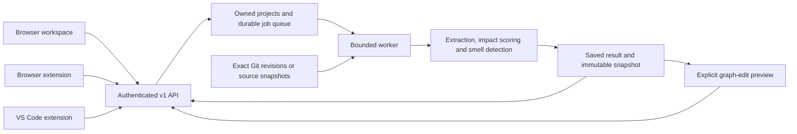

# Microservice Drift Tracker (MDT)

[](https://fastapi.tiangolo.com/)
[](https://react.dev/)
[](https://neo4j.com/)
[](https://www.trychroma.com/)
[](https://www.docker.com/)

MDT is an academic alpha for cross-service change impact and architectural-debt analysis. It connects exact Git revisions or deliberately submitted source snapshots to a service graph, explains the available evidence, and evaluates proposed graph edits. Scores are engineering indicators, not calibrated incident probabilities or guarantees that a deployment is safe.

- [Current implementation and zero-cost release runbook](docs/PUBLIC_ALPHA.md)
- [25 October release checks, local packages and outstanding gates](docs/RELEASE_READINESS_2026-10-25.md)
- [Professional support scope, measurable acceptance gates and remaining evidence](docs/PROFESSIONAL_READINESS.md)
- [27 October running-backend checks and refreshed hosted-image security scan](docs/RUNTIME_VALIDATION_2026-10-27.md)
- [Report audit, prioritized implementation plan, and research backlog](docs/IMPLEMENTATION_PLAN.md)
- [Validation results and remaining release gates](docs/VALIDATION.md)
- [Current implementation checklist and remaining work](docs/IMPLEMENTATION_STATUS.md)
- [Backup, restore and rollback procedure](docs/OPERATIONS.md)
- [Browser and VS Code extension installation](extensions/README.md)

## Start locally

Requirements: Docker Desktop with Compose v2, and Git. Model-provider credentials are optional; deterministic analysis works without them.

```powershell
docker compose up -d --build
```

Open [MDT in your browser](http://localhost:5173). The public example works without signing in. The local development defaults are `admin` / `admin123` unless overridden by `backend/.env`. Hosted configuration rejects those defaults.

If configuration is needed, copy `backend/.env.example` to `backend/.env`, then edit that local file. Never commit credentials. The default development JWT key is ephemeral, so restarting the backend ends those sessions; set a persistent strong key for a controlled environment.

| Local service | Address |
| --- | --- |
| Web UI | http://localhost:5173 |
| API and interactive OpenAPI reference | http://localhost:8000/docs |
| Neo4j browser | http://localhost:7474 |
| ChromaDB | http://localhost:8005 |
| Four runnable example services | Ports 8001–8004 |

To rebuild only the application while keeping the existing databases and demo services:

```powershell
docker compose up -d --build backend frontend
```

## Two runtime profiles

| Capability | Local research stack | Hosted academic alpha |
| --- | --- | --- |
| Browser workspace and `/v1` API | Yes | Yes |
| Owned projects, saved analyses, leased jobs | SQLite by default | PostgreSQL required |
| Immutable project snapshots and deterministic previews | Yes | Yes |
| Public illustrative example | Yes | Yes, with a bundled static fallback |
| Local service diagnostics, Neo4j and ChromaDB research APIs | Available locally | Disabled |
| LLM and semantic retrieval | Optional legacy research integrations | Disabled |
| GitHub access | Local checkout or configured credentials where applicable | Public repositories only |
| User provisioning | Local defaults; optional viewer signup | Administrator-provisioned analysts |

The hosted image omits Neo4j, ChromaDB and model-provider packages. It runs as a non-root user, uses one bounded worker, and stores records in a private PostgreSQL `mdt` schema. It never executes imported repository code.



## Implemented capabilities

- Three main destinations (Projects, History, Account), one graph view, lazy loading and visibility-aware job polling.
- Searchable owned history, immutable baselines, captured topology/contract drift, readable exports, expiring finding reviews and explicit dependency rules. See [current scope and limits](docs/IMPLEMENTATION_STATUS.md).
- Python AST contract evidence and bounded Tree-sitter JavaScript/TypeScript/TSX parsing. Dynamic/generated routes and cross-file schemas remain partial.
- Exact before/after revision extraction, including additions, deletions, renames and push ranges. Python uses AST analysis; unsupported or incomplete parsing is reported explicitly.
- Bounded Compose/Render/file-tree onboarding that preserves declared dependencies and records the resolved revision and coverage.
- Ten configurable architecture-smell rules over a shared immutable graph model. Service, database and external targets are distinguished; graph patterns are not presented as measured network traffic.
- Separate change-impact and architectural-debt scores. API contract changes use method/path evidence; lexical-only or missing semantic evidence contributes no semantic modifier.
- Counterfactual previews that report introduced, resolved and unchanged findings using the same detector. Names such as “gateway” do not automatically improve scores. Optional local Neo4j experiments roll back their transactions.
- Account-owned projects and results, current-role checks, short-lived bearer sessions, refresh/logout revocation, idempotent submissions, quotas, cancellation and recovery of interrupted jobs.
- Browser workspace with job progress, saved-result links, JSON export, source coverage and graph previews. The static public demo remains available when the API is unavailable.
- Manifest V3 browser extension and dual-entry VS Code extension sharing the same API client. Desktop VS Code reads real staged or saved working-tree content only after workspace trust and upload consent. Its browser entry submits confirmed repository/revision identifiers without reading workspace files.

Default limits include 5 projects/account, 2 active jobs/account, 30 jobs/day/account, 180 seconds/job, 30-day result retention and a 5 MiB request body. Source extraction and preview work have additional bounds; see the release runbook.

## Scoring and evidence

The deterministic change score sums configured file-count, API-contract, core-service, dependency-depth, schema and infrastructure factors, capped at 100. Optional local semantic evidence may modify that score; hosted and scoped jobs use zero semantic modification. Default severity boundaries are 25, 50 and 75.

Architectural debt is a separate bounded aggregation of smell severities. A lower counterfactual debt score does not prove that a proposed refactoring preserves business behavior. Confidence labels and illustrative history are not benchmark accuracy results.

The ten categories are circular dependency, bottleneck service, high coupling, isolated service, dependency growth, API instability, shared database, chatty-communication proxy, missing circuit-breaker evidence and hub-and-spoke centralization. Some require recorded history; missing history is not synthesized for imported projects. Cycle enumeration is bounded to eight nodes.

The runnable demo fleet contains `user-service`, `order-service`, `payment-service` and `notification-service`. The illustrative snapshot also models a database target and an unresolved external inventory dependency. Those targets are not additional runnable services. Read health and scores from the running application, not fixed values in documentation.

## API overview

The running [OpenAPI reference](http://localhost:8000/docs) is the authoritative route schema.

| Method | Route | Purpose |
| --- | --- | --- |
| GET | `/health/ready` | Database readiness |
| GET | `/v1/demo` | Public illustrative snapshot |
| POST | `/auth/login`, `/auth/refresh`, `/auth/logout` | Start, rotate or revoke a session |
| POST | `/auth/invite` | Administrator provisions an analyst; no email is sent |
| GET / POST | `/v1/projects` | List or create owned projects |
| GET / DELETE | `/v1/projects/{id}` | Read or delete an owned project and its jobs |
| POST | `/v1/projects/{id}/analyses` | Queue import, revision, PR or source-snapshot analysis |
| GET / DELETE | `/v1/jobs/{id}` | Retrieve a job/result or cancel work |
| GET | `/v1/analyses/{id}` | Saved-analysis alias |
| POST | `/v1/analyses/{id}/previews` | Evaluate explicit edits on the saved snapshot |

Local legacy routes under `/services`, `/registry`, `/analysis` and `/webhook` are absent from the hosted profile. Local GitHub push webhooks verify HMAC-SHA256 signatures and enqueue durable jobs. End-user GitHub App installation routing, PR status publication and review comments are later milestones, not delivered hosted features.

## Extensions and Git hook

See [extensions/README.md](extensions/README.md) for unpacked browser ZIP and VSIX installation. Extensions connect to your API endpoint using an MDT session token; never enter database, model-provider or GitHub secrets into them. The VS Code browser-worker entry is implemented and tested in a real local worker host; deployed `vscode.dev` installation and HTTPS/CORS acceptance remain release gates.

The separate Git hook currently targets the authenticated **local legacy API**, not the hosted `/v1` API. Configure `MDT_API_URL` and `MDT_API_TOKEN`, then:

```powershell
python mdt-hook/mdt_check.py --staged
python mdt-hook/mdt_check.py --working
python mdt-hook/mdt_check.py --install-hook pre-push
```

Staged mode reads the Git index. Working mode reads saved files. Pre-push uses Git's actual local/remote ref pairs. Extraction failures and partial results block by default; `MDT_ON_ERROR=warn` explicitly changes that failure policy. `MDT_FORCE=1` overrides a risk block, not an extraction failure. Hook results remain research guidance and do not establish deployment safety.

## Testing

Python 3.11 is the deployment target. Use an isolated source copy so tests cannot load real credentials or mutate the local registry:

```powershell
python -m venv .venv-alpha
.\.venv-alpha\Scripts\python.exe -m pip install -r backend/requirements-hosted.txt -r requirements-test.txt
.\.venv-alpha\Scripts\python.exe scripts/test_isolated.py -q
npm.cmd --prefix frontend ci
npm.cmd --prefix frontend test
npm.cmd --prefix frontend run lint
npm.cmd --prefix frontend run build
```

PostgreSQL and Neo4j integration tests require explicit test connection settings. See [validation evidence](docs/VALIDATION.md) and the [runbook](docs/PUBLIC_ALPHA.md) for scope and commands. The local CI workflow also validates the shared client and both extensions; it does not publish anything.

## Project map

- `backend/domain/architecture.py`: canonical graph snapshots and smell rules.
- `backend/api/projects.py`, `backend/core/store.py`: owned API, durable state and worker.
- `backend/services/`: Git extraction, onboarding, impact analysis, retrieval and previews.
- `frontend/`: web workspace and optional local dashboard.
- `packages/client/`, `extensions/`: shared client, browser extension and VS Code extension.
- `mdt-hook/`: local Git gate.
- `services/`: four runnable reference services.
- `tests/`, `scripts/`: regressions and isolated runtime smoke checks.

Older documents such as `docs/ARCHITECTURE.md`, `docs/features.md`, `docs/API.md`, `docs/deployment.md` and `docs/github_app.md` describe the earlier research stack. Use the dated alpha runbook, implementation plan and current OpenAPI schema where behavior differs.

## Publication and licensing

The zero-cost plan uses a static frontend, a sleeping free API service and durable free PostgreSQL. Cloud deployment and extension-store publication require account configuration and separate publication steps. The [release runbook](docs/PUBLIC_ALPHA.md) documents cold starts, quotas, installation and the remaining gates.

A root license file has not been supplied. Confirm licensing with the project owners before public distribution; this repository does not assert an MIT license. Package manifests currently mark the local extension alpha as unlicensed.
