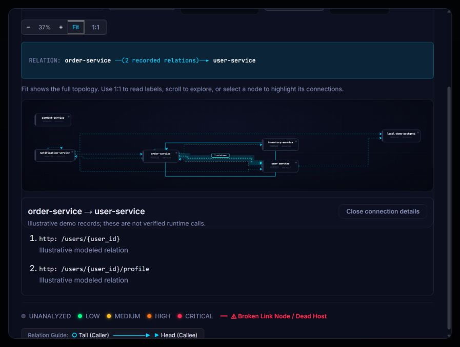

# Local alpha completion — 23 October 2026

This pass closes the graph presentation, evidence-labeling and stale-demo gaps left after the backend 2.1.0 fixes. It also rebuilds the browser and VS Code packages. Public deployment and store publication are not complete.

## Implemented

| Gap | Completed behavior | Verification |
| --- | --- | --- |
| Multiple endpoint records look like duplicate service links | Default graph groups records by directed service pair; its badge shows the record count. Selecting a connection lists every method, endpoint and recorded provenance. Individual-relations view remains available. | Demo: 11 records → 10 connections; order → user details contain both endpoints; keyboard activation checked in Browser |
| Dense graphs require too many separately routed lines | Grouping reduces drawing work without changing snapshots, scores, direction or evidence records | OpenTelemetry: 102 relations → 58 connections; eShop: 41 → 28; Saleor: 13 → 7 |
| Missing/zero debt looked reassuring | Missing/invalid values stay unavailable. Partial and startup-only evidence have neutral assessment labels. Zero gets a true zero-length meter, rather than a manufactured 5% fill. | Regression tests for empty/blank/boolean/nonfinite values, explicit zero, partial and modeled results |
| New backend evidence absent from user-facing reports | Summary, Findings, Markdown/HTML exports, shared extension summaries and VS Code views disclose the architecture assessment and limits | Frontend/shared-client/editor tests; live saved-import navigation |
| Import findings were hidden behind “No change analysis selected” | Import jobs now use the normal result view, keep the correct project/job links, and expose their static findings without inventing commit risk | Retained OpenTelemetry import opens 16 historical findings with detector 2.0.0 identified |
| Offline demo still used detector 2.0.0 | Recomputed fixture, scores and previews with 2.1.0. Added isolated generator and CI parity check | `python scripts/export_demo.py --check` passes; no user data or credentials enter the fixture |
| Distribution artifacts lagged behind client code | Rebuilt browser ZIP, desktop/web VSIX and public-profile frontend ZIP; recorded file hashes | Package contents inspected; [release manifest](benchmarks/release-artifacts-2026-10-23.json) |

The two demo order → user endpoints are `/users/{user_id}` and `/users/{user_id}/profile`. Both are illustrative registry records; the runnable order service currently calls only the first. Grouping changes presentation, not detector inputs. No endpoint, score or repository-specific position was invented.

## Validation

- **19 frontend tests**, lint and production builds passed.
- **7 shared-client, 10 browser-extension and 9 VS Code unit tests** passed. These extension tests do not establish installed Chrome/Edge or deployed vscode.dev acceptance.
- **20 targeted backend tests** passed (demo preview and repository-evidence regressions). All backend source hashes still match the preceding **355-pass** full PostgreSQL/Neo4j run; this pass made no backend implementation changes.
- **36 new geometry combinations**: eight updated imported graphs plus the demo, in both directions and both detail modes. No node overlaps, route/node intersections, badge/node intersections, badge/badge overlaps or shared overlapping line segments. Dense graphs still have perpendicular crossings. [Measurements](benchmarks/graph-completion-2026-10-23.json).
- Browser verifies grouped/individual edge counts, keyboard inspection, stable geometry with details open, actual saved-import Findings navigation and preserved historical detector identity. At an observed 390 × 844 viewport the dialog has no horizontal overflow and both endpoint details remain available; temporary resizing was reset. No browser console errors were captured. [Browser evidence](benchmarks/alpha-completion-browser-2026-10-23.json).
- Demo parity, Nginx configuration and Git whitespace checks passed. Local dashboard controls are enabled in the running Docker build; the separately packaged public-profile web build disables them.

[All 400 named checks](TEST_INVENTORY.md) distinguish the current client runs from the unchanged backend's preceding full run. The initial new export assertion failed because Markdown escaped an underscore in a raw evidence key; reports were improved to use readable evidence-count labels and all tests passed afterward.

## Fresh website runs

The three retained QA projects were re-imported and reanalyzed through Browser at their original pinned heads: six real jobs, all completed with partial evidence. Each matches the corrected backend replay. Their historical results and the user's original MDT project were preserved.

| Retained project | Current topology | Observed debt | Commit risk | Evidence limit |
| --- | --- | ---: | ---: | --- |
| Voting app | 6 nodes / 5 relations | 0 | 40 | Only startup relations captured; insufficient communication evidence |
| Spring Petclinic | 11 nodes / 13 relations | 0 | 5 | Only startup relations captured; insufficient communication evidence |
| OpenTelemetry | 20 nodes / 102 relations | 89.573 | 55 | 46 startup, 55 configuration and 1 static call record; runtime traffic unmeasured |

OpenTelemetry's website graph draws 58 grouped connections or all 102 individual records, with finite geometry and zero measured node overlaps. Detailed scores, warnings and saved result URLs are in the Browser evidence JSON. The global registry SHA-256 remains `62d9fa65357611e73aebbf67ecb10cc9c6aef98d4d4b997821abcf32b216658e`.



## Local artifacts

- Browser: `extensions/browser/mdt-browser-alpha-0.1.0.zip` (extract and Load unpacked).
- VS Code: `extensions/vscode/mdt-architecture-review-0.1.0.vsix` (desktop and web entry points).
- Web: `scratch/alpha-completion-2026-10-23/mdt-web-alpha.zip`.

The web ZIP currently uses `/api`, suitable for the local/same-origin proxy and the recorded public demo. A standalone static host needs a rebuild with its actual HTTPS API URL, or a configured same-origin API proxy. Build-time configuration is not a deployment. The VSIX still has its explicitly local publisher identity and `UNLICENSED` metadata; it is a review/sideload artifact.

To regenerate the recorded example, use Python 3.11 with backend dependencies installed:

```powershell
python scripts/export_demo.py
python scripts/export_demo.py --check
```

The generator copies backend source to a disposable directory, excludes local environment/data, and recalculates only the canonical fixture and its previews. CI checks for drift; updating detector code requires regenerating the asset.

## Still required for publication

1. Actual hosting accounts and API/web URLs, database connection and production secrets. Apply the prepared configuration and test HTTPS, exact CORS, sleep/restart behavior and backup restore against those services.
2. Contributor-approved license, real publisher identity, support contact and hosted privacy-policy URL. These are owner decisions and cannot be inferred from code.
3. Interactive Chrome/Edge extension acceptance and deployed vscode.dev consent/CORS tests. Existing simulated and editor-host checks do not substitute for those environments.
4. Independent labeled evaluation before academic accuracy claims. Runtime tracing, complete gRPC/C# contracts, general Aspire helper evaluation and Helm/Kustomize rendering remain research/parser scope, not completed features.

The detailed release procedure remains in [PUBLIC_ALPHA.md](PUBLIC_ALPHA.md). No commit, GitHub push, public deployment, account creation or extension-store submission occurred.
