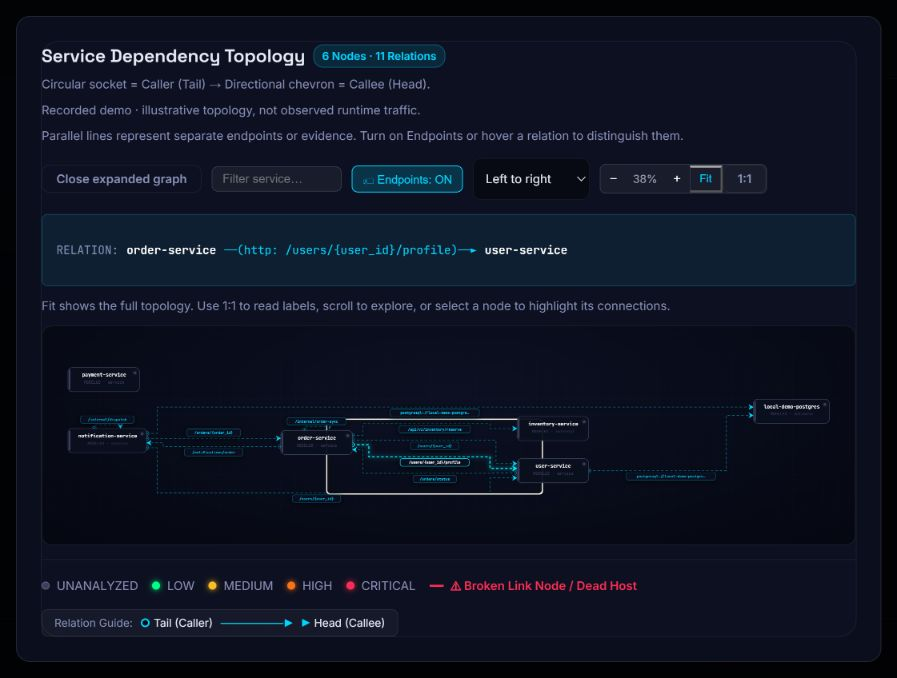

# Repository evidence and graph hover fixes — 22 October 2026

The ten repositories from the previous website audit were replayed at the same pinned head revisions through the updated importer, detector and deterministic risk engine. Eight now yield partial topology evidence; Ponytail and Express still abstain. The backend detector is **2.1.0**. The rebuilt local backend and frontend are running.

These results replace the earlier numbers for new imports using this code. Existing saved jobs remain historical records: **re-import and reanalyze to get the new results**. This replay used an isolated source copy and database, not another round of website submissions or the user's analysis quota. No downloaded repository code, dependency installer or build hook was executed.

## Reproducible results

[Full results and backend source hashes](benchmarks/backend-evidence-2026-10-22.json) · [CSV comparison](benchmarks/backend-evidence-2026-10-22.csv) · [Replay script](../scripts/recheck_repository_evidence.py) · [Original website audit](LIVE_WEBSITE_AUDIT.md)

Each arrow compares the original website capture with the current replay. Relations are typed evidence records, not a count of observed runtime calls. Architectural debt and commit risk are different heuristic measures; they are not independently calibrated accuracy or repository-quality ratings.

| Repository | Nodes | Relations | Observed architectural debt | Commit risk |
| --- | ---: | ---: | ---: | ---: |
| DietrichGebert/ponytail | Unavailable | Unavailable | Unavailable | Unavailable |
| GoogleCloudPlatform/microservices-demo | 12 → 12 | 16 → 16 | 80.769 → 78 | 40 → 40 |
| fastapi/full-stack-fastapi-template | 5 → 4 | 2 → 3 | 45 → 0 | 5 → 5 |
| dockersamples/example-voting-app | 6 → 6 | 5 → 5 | 52.174 → 0 | 40 → 40 |
| microservices-demo/microservices-demo | 17 → 14 | 1 → 1 | 60 → 0 | 5 → 5 |
| spring-petclinic/spring-petclinic-microservices | 11 → 11 | 13 → 13 | 72.152 → 0 | 5 → 5 |
| open-telemetry/opentelemetry-demo | 20 → 20 | 47 → 102 | 88.004 → 89.573 | 40 → 55 |
| dotnet/eShop | Unavailable → 17 | Unavailable → 41 | Unavailable → 82.677 | Unavailable |
| saleor/saleor-platform | 7 → 7 | 5 → 13 | 54.545 → 65.625 | 15 → 15 |
| expressjs/express | Unavailable | Unavailable | Unavailable | Unavailable |

Zero means **no findings supported by the captured evidence**, not a safe or debt-free architecture. Voting and Spring have only startup relations in this capture; their architecture assessment explicitly says `insufficient_communication_evidence`. FastAPI and Sock Shop also remain partial. More captured dependencies can increase a score: OpenTelemetry's increase follows newly resolved configuration references and corrected dependency-depth calculation, not an adjusted expected score.

No repository-name rules, expected-score overrides or changes to score weights were introduced. The tests use unrelated service names to check general behavior. Pinned revisions, archive hashes, evidence counts, warnings, findings and source hashes are recorded in the JSON. Replay durations include public GitHub metadata/source retrieval and are not pure algorithm benchmarks. eShop has no comparable pinned parent analysis in the original audit, so no commit-risk result is invented.

## Backend defects and changes

| Defect found | Implementation | Evidence and boundary |
| --- | --- | --- |
| Startup ordering inflated coupling, cycles, chatter and missing-resilience findings | Central relation classification separates startup, configuration and call evidence; detectors and impact traversal exclude startup where inappropriate | Regression tests plus all ten replays; ordering remains visible in the graph |
| Configuration callbacks became synchronous call cycles | Cycle/chatter checks require supported call evidence | Aspire callback control produces no synchronous-cycle finding |
| Unobserved resilience became `false` | Imported absent resilience stays unknown; missing-circuit-breaker finding requires explicit negative evidence and call fan-out | Tests cover unknown and explicitly false cases |
| Missing captured edges produced false isolated-service findings | Imported partial graphs abstain from runtime isolation judgments | Voting/Spring no longer accumulate findings from absent call evidence |
| Static calls overwrote startup edges and collapsed distinct endpoints | Preserve provenance, protocol, method and endpoint identity; merge duplicate identical calls only | Two distinct API paths survive alongside startup ordering |
| Scoped impact depth returned zero or measured fan-out | Traverse the captured project graph; bounded breadth-first search computes largest shortest-path distance; cycles cannot inflate depth | Scoped-registry, chain, cycle, fan-out and startup exclusion tests |
| Same depth query repeated for many changed files | Calculate depth once per affected service | Existing impact suite and new scoped regression pass |
| Compose interpolation and tracked environment files hid declared dependencies | Resolve recorded `.env` defaults and bounded in-repository `env_file` values with inline overrides; no host environment or shell evaluation | OpenTelemetry 55 configuration references; Saleor 8 additional environment references |
| Port parsing invented or lost published/container ports | Handle host-IP, protocol suffix, long syntax and `expose`; leave unresolved ranges/published values unknown | Six parameterized port cases |
| Configuration URLs could retain credentials/query secrets | Keep sanitized endpoint evidence and exact internal target matching | Literal/unknown/external-host and credential sanitization regressions |
| Alternative deployment manifests mixed application and monitoring resources | Prefer root Compose declarations; select one closest plain Kubernetes manifest directory and report excluded alternatives | FastAPI root deployment has 4 nodes; Sock Shop canonical deployment has 14 |
| .NET Aspire topology was unsupported | Parse a bounded literal AppHost subset for projects, resource declarations, references, endpoint references and startup waits | eShop 17 nodes/41 relations; helpers/conditionals are not executed or guessed |
| Infrastructure names were mistaken for application source ownership | Only application-service nodes receive matching-folder fallback ownership | EventBus library no longer becomes broker source ownership |
| Evidence disappeared during immutable snapshot/Neo4j conversion | Preserve explicit relation provenance and coverage; include them in snapshot identity | Full snapshot, preview/parity and transactional Neo4j suite passes |
| Zero findings could be consumed without evidence qualification | Health output includes assessment status, evidence counts, unassessed rules and interpretation | Startup-only zero-score regression; demo/project/analysis/drift/preview paths carry snapshot context |

The startup distinction follows [Docker's Compose startup-order documentation](https://docs.docker.com/compose/how-tos/startup-order/). Environment-file handling follows the supported subset of [Compose service configuration](https://docs.docker.com/reference/compose-file/services/). Aspire discovery follows literal resource relationships described in [Aspire project resources](https://aspire.dev/integrations/dotnet/project-resources/); it is deliberately not a C# evaluator.

## Graph hover stability and creation cost

Code inspection identified three interacting hover hazards: the relation banner could change height when text wrapped, newly displayed badges could intercept the stationary pointer, and animated visual strokes/ports participated in hit testing. These mechanisms could trigger repeated leave/enter and fit recalculation. The earlier intermittent jitter was user-reported; it was not consistently reproduced in the pre-fix sample.

- Reserve a fixed 72px relation banner, with scrolling for long text. Hover cannot move or resize the drawing area.
- Use one transparent, non-scaling hit stroke per relation. Badges, arrows, ports and animated visual strokes do not intercept pointer events.
- Memoize edge/badge rendering and stabilize hover callbacks. Resize observation ignores unchanged dimensions.
- Cache four completed topology/direction layouts using least-recently-used eviction. Returning to an unchanged graph reuses its geometry; failed/in-flight results are not cached.
- Keep distinct endpoint relations, direction controls, Fit, 1:1, expansion and keyboard edge inspection.

[Browser measurements](benchmarks/graph-hover-2026-10-22.json) record **all 11 demo relations**, six stationary-pointer geometry/text samples each at 100ms intervals. Each relation had one unchanged frame signature. An additional check at an observed **390 × 844 CSS-pixel viewport** also stayed stable. At that fit scale, nearby hit areas overlap, so the narrow check records the actual selected relation rather than claiming every tiny edge is individually targetable. Use 1:1 for precise inspection. Endpoint badges reported `pointer-events: none`; both graph directions rendered, and the browser error log was empty. Temporary viewport overrides were reset.

These checks establish sampled stability, not an FPS, all-device or long-duration hardware-hover guarantee. Prior geometry checks still cover eight saved graphs in two directions, including dense cyclic graphs. Dense graphs can retain perpendicular crossings and small labels at Fit.

## Validation completed

| Check | Result |
| --- | --- |
| Full backend suite | **355 passed in 112.18s**, including disposable PostgreSQL and real transactional Neo4j integration |
| Added backend regression file | **19 cases**, all included in the full suite |
| Frontend suite | **14 passed**, including layout geometry and bounded cache eviction/reuse |
| Ten pinned repository replays | Eight partial topologies, two explicit abstentions; stable repeated snapshot/findings checks |
| Live demo link inspection | 11 relations stable across six samples each; additional 390px-width sample stable |
| Frontend lint / production build | Passed |
| Nginx configuration / local API smoke | Passed; backend healthy and demo reports detector 2.1.0 |
| Git whitespace | Passed |

The first test container lacked pytest; the existing test-runtime image was used instead. An intermediate suite exposed three assertions expecting the previous health payload without the new evidence metadata; the tests were updated to compare the full snapshot-aware result, and the final suite passed. The temporary PostgreSQL container was removed after testing. The broader [named test inventory](TEST_INVENTORY.md) includes 393 checks across all suites; shared-client and extension checks retain their earlier 22 October execution, while this pass reran backend and frontend.

The original MDT project, four demo services and global registry were preserved. The global registry checksum remained `62d9fa65357611e73aebbf67ecb10cc9c6aef98d4d4b997821abcf32b216658e`. Local images were rebuilt using the already validated local runtime layers. This is not a new dependency/security audit, a public deployment or a GitHub publication.

## Remaining limits

- Re-import/reanalyze saved projects to produce results with detector 2.1.0; historical reports are not silently rewritten.
- Static configuration is partial evidence. Runtime traffic, dynamic service discovery, complete gRPC/C# contract extraction and applications supplied only as external images remain incomplete.
- Aspire helpers, conditionals, custom resource builders and ambiguous multiple AppHosts require broader parsing or explicit selection. Unsupported constructs are reported, not executed.
- Kubernetes selection covers a plain manifest set, not rendered Helm/Kustomize environments. A deployment selector would improve ambiguous repositories.
- Scores still need independent labeled evaluation and calibration before accuracy claims in the academic report. These controls repair concrete extraction/detection errors; they do not measure production incident prediction.
- Public hosting, installed extension acceptance and store publication remain separate release gates in [PUBLIC_ALPHA.md](PUBLIC_ALPHA.md).
