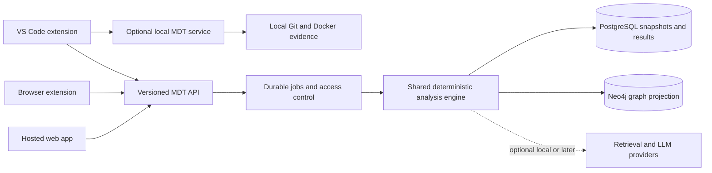

# MDT implementation and public alpha plan

Prepared 16 October 2026 for a zero budget academic release. The historical client status below is dated 18 October. See [IMPLEMENTATION_STATUS.md](IMPLEMENTATION_STATUS.md) for the current 19 October implementation and remaining work.

This document preserves the original audit and target backlog. Baseline evidence, source line references and estimates below describe the 16 October review and may no longer match the modified checkout. Use [PUBLIC_ALPHA.md](PUBLIC_ALPHA.md) for current API behavior, limits, build/install commands and release gates. Local implementation is not evidence of cloud deployment, store publication or a completed research evaluation.

## Client delivery status, 18 October 2026

| Surface | Implemented locally | Verification and remaining work |
| --- | --- | --- |
| Web | Owned project/import/job workspace; cancellation; project/job hash links; graph/evidence views; three-decimal scores; JSON export; structured graph previews; sessionStorage bearer and cache clearing; recorded demo fallback; hosted API configuration | 4 Node tests, clean lint, production build and zero-vulnerability dependency audit passed. Real workflow, accessibility and two-account acceptance results must be recorded independently; Markdown/HTML exports and feedback are not implemented |
| Browser | Manifest V3 popup, explicit GitHub URL context, project selection, job polling/recovery, cancel/open-report actions, optional API-origin permission, session-only bearer storage; local ZIP | 3 tests and build passed, package contents inspected. No real Chrome/Edge host verification or store submission yet; no page overlay, pairing flow or separately scoped extension credential |
| VS Code | Desktop staged/index and saved-working full snapshots, explicit upload consent, Workspace Trust gate, SecretStorage, output/verified source diagnostics, saved-job refresh and web links; local VSIX | 2 Git-fixture/path tests and VSIX packaging passed. No real editor-host verification yet; findings tree/status bar, in-editor repair preview, commit/branch commands and browser-only VS Code are not delivered |
| Shared SDK | `packages/client` JavaScript client used by both extensions; URL validation, redirect rejection, bounded requests, GitHub-context parsing and score summaries | 4 tests passed. Frontend retains its Axios API adapter; generated TypeScript types and a shared result-component package remain proposed |

The extensions have built artifacts, not completed acceptance certification. Clean-profile browser tests, real VS Code installation/restart/Restricted Mode checks, cross-platform testing and identical-input cross-client parity remain release gates. Exact local commands and artifact locations are in [the runbook](PUBLIC_ALPHA.md#build-and-install-the-clients-locally). No client build command publishes anything.

The recommended direction is one dependable analysis engine with three clients: the hosted web app, a browser extension, and a VS Code extension. Keep the full Docker environment for local research and demonstrations. Publish a bounded, deterministic hosted alpha first, then extend its API into the editor and browser.

The strongest feature is the ability to explain a change through its service graph and compare a proposed architectural repair. Correctness, reproducibility, and honest evidence labels should lead the release. Adding more AI features before these foundations are fixed would make the result harder to trust.

## Scope and evidence

This plan follows the confirmed preference for **a public demo plus an invite-only beta, with ₹0 expenditure for now**. “Private beta” means invited testers; it does not automatically mean support for uploading private repositories. Start with public repositories and add private source only after access controls, retention, and isolation pass their acceptance tests.

Reviewed inputs:

- [Supplied IEEE paper](<C:/Users/DELL/Downloads/MDT_IEEE_Paper (4).docx>): all extracted sections, equations, five tables, references, and both embedded figures.
- [Original requirements](<D:/projects/project 1/docs/references/Microservice_Drift_Tracker_Requirements.docx>) and [design document](<D:/projects/project 1/docs/references/Microservice_Drift_Tracker_Design.pdf>): the intended product and research scope, including the four-service prototype, contract analysis, code retrieval, and evaluation objectives.
- Backend modules, API routes, frontend components, hook, test definitions, deployment configuration, service fleet, and project documentation in the current checkout.
- Official hosting, extension, GitHub, parser, and Neo4j documentation, linked alongside relevant decisions below. Free-tier terms were checked on 15–16 October 2026 and must be checked again when accounts are created.

At the original read-only review, the repository was clean on branch `feat/live-docker-integration`, at commit `0b6dd74`. That review did not modify application source, the report, runtime configuration or GitHub state. Implementation was subsequently authorized and changed the local checkout; this repository copy of the plan now records the original baseline alongside the dated client status above.

The original audit was not a certification that the running system passed. Docker runtime validation was unavailable then, and an isolated test attempt could not start because the repository virtual environment pointed to unresolved `C:\Python314\python.exe`. The bundled document runtime also lacked application test dependencies; no passing test count was asserted for that baseline. Those historical blockers do not describe the later client checks listed above. The paper's text and embedded figures were inspected; its Word page layout was not rendered because the bundled Windows runtime did not provide LibreOffice.

Instructions embedded in the original specifications are treated as historical design material, not as authorization to implement, publish, change ownership, or push code.

## Recommended release scope

| Release | User experience | Boundary |
| --- | --- | --- |
| Public demo | Open the site, explore the existing four-service example, inspect findings and score explanations, open a reproducible recorded analysis | Curated, read-only data; clearly labeled snapshot, with commit and capture time |
| Hosted alpha | Invited users analyze bounded public repositories or approved sample commits; inspect graph, impact, debt, evidence and valid previews | Deterministic engine, explicit parser coverage, quota limits, persistent results; no automatic source execution |
| VS Code alpha | Analyze staged or working changes, navigate findings, open the same analysis in the web app | Desktop first; explicit consent before sending code; local mode supported |
| Browser alpha | On a GitHub PR or commit, request or view its analysis in a popup and open detailed web results | Chrome unpacked distribution and Edge store path; minimal permissions |
| Later beta | Private repositories, reliable GitHub checks, richer contract diffing, semantic retrieval, additional languages | Requires stronger isolation, verified provenance, retention controls, and measured capacity |

Keep optional AI explanations disabled by default in the ₹0 hosted profile. A deterministic explanation should remain useful without a model key. Preserve the full semantic and LLM configuration for local research, but label which evidence was actually used in each result.

## Original baseline: what existed and what needed work

The 16 October baseline contained useful building blocks. The table below records that audit, not the current implementation state.

| Area | Evidence in this checkout | Assessment |
| --- | --- | --- |
| Web dashboard | Overview, import/reset, impact analysis, graph, smells, history, login, health views | Substantial interface exists; needs hosted modes, routing, accessibility, job progress and browser tests |
| Analysis engine | Deterministic factors, graph impact, historical retrieval, explanations | Preserve the deterministic core; improve change extraction and evidence quality |
| Smell catalogue | Ten categories in live and registry paths | Preserve coverage; unify detector logic and validate false positives |
| Remediation preview | Real transaction rollback path plus a heuristic fallback | Highest correctness priority; current fallback does not substantiate the paper's measured-preview claim |
| Repository onboarding | Compose, directory and entrypoint inference | Useful start; incomplete multi-file coverage and single active project state |
| Identity | JWT, password hashing, roles, production default-secret checks | Controls exist, but public routes and global data prevent safe multi-user hosting |
| GitHub integration | Signature verification, background processing, GitHub App support | Needs event ranges, authorization, durable jobs, delivery deduplication and retry handling |
| Local hook | Staged/working/last-commit modes and installation | Sends file names and HEAD rather than actual staged/working content; cannot yet underpin accurate IDE analysis |
| Persistence | Registry/user JSON, process-local history, Neo4j, Chroma | Must move durable hosted state off local disk and scope it by project |
| Testing and delivery | Fifteen test modules, frontend build/lint scripts, Compose | Test expectations drift; no checked-in CI workflow or extension projects found |

## Original release blockers and required modifications

These are the target requirements established by the audit. An item is not automatically still missing, or fully verified, merely because it appears here; use the current runbook and measured acceptance results to determine completion.

### A1 Make remediation previews measure the proposed graph

Evidence: [fallback simulation](<D:/projects/project 1/backend/services/remediation_simulator.py:996>) decrements smell counts based on edit type or names such as `_gateway` and `_facade`. Removing an arbitrary edge can reduce the cycle count without proving that edge belongs to a cycle. Adding an edge cannot faithfully detect a newly introduced cycle through this mechanism. The [live path](<D:/projects/project 1/backend/services/remediation_simulator.py:899>) has its own detector queries and can accept caller-supplied baseline counts. Some mutation and detection behavior also treats name suffixes specially.

Implement a single canonical detector operating on a versioned graph snapshot. Graph nodes and edges must have explicit types and properties; a name must not grant resilience or remove debt. Apply a validated edit list to a copy and evaluate the same detector before and after. Keep the Neo4j transaction adapter for the research experiment, using the same detector semantics and guaranteed rollback. If the hosted path uses immutable snapshots instead of live transactions, describe that difference in the paper and UI.

Recompute the baseline on the server from the referenced snapshot. Reject stale baselines, unknown services, invalid edge operations, unsupported edit types and excessive edit counts. Return individual findings introduced, resolved and unchanged, including any functional dependency that was removed. A reduced smell score does not demonstrate preserved application behavior.

**Acceptance:** an edit that leaves the assessed structure unchanged gives zero structural improvement; adding a real cycle worsens the result; removing an unrelated edge does not “fix” a cycle; renaming a node does not change its debt; every exception path preserves the original graph. Genuine new isolation or other side effects must be reported, even when an edit was intended to be unrelated. Live and snapshot adapters must agree on equivalent inputs.

### A2 Preserve score resolution through the whole API

Evidence: [_normalize_score](<D:/projects/project 1/backend/services/remediation_simulator.py:705>) returns three decimals, but [live response serialization](<D:/projects/project 1/backend/services/remediation_simulator.py:968>) and the fallback response round to one. The [score regression test](<D:/projects/project 1/tests/test_remediation_simulator.py>) still expects one-decimal values in several assertions.

Store raw debt, normalized debt, normalization constant, detector version and weighting configuration. Preserve at least three decimals in response values and deltas; choose display precision deliberately. Compute comparisons on unrounded values, with a documented numeric tolerance. Keep commit deployment risk separate from architectural debt everywhere, including exports and extension badges.

**Acceptance:** the paper's five scenarios reproduce raw debt 244, 214, 184, 154 and 124 with normalized values 86.936, 85.372, 83.384, 80.769 and 77.178. Fine changes remain visible through API, UI, export and history. Refresh stale tests to reflect the intended specification, then run the full suite.

### A3 Introduce project ownership and isolation

Evidence: [RegistryManager](<D:/projects/project 1/backend/core/registry.py:173>) has one cached registry and one JSON file. [Neo4j constraints](<D:/projects/project 1/backend/services/dependency_graph.py:140>) identify services globally by name and files globally by path. The manual analysis repository guard is useful, but it protects a single active project rather than independent workspaces.

Introduce `workspace_id`, `project_id`, immutable repository identity, `snapshot_id`, `base_sha` and `head_sha`. Every registry record, graph query, cache key, history row, vector chunk and job must carry its scope. Use composite graph identity or stable scoped IDs, including edge endpoints. Derive authorization from the authenticated user's membership; a client-supplied project ID is not proof of access. Make registry imports atomic and versioned.

**Acceptance:** two users can analyze repositories with identically named services and file paths without mixing data; concurrent imports cannot replace each other's topology; user B cannot read, delete, preview or infer user A's private analysis by guessing an ID. Restarting the backend does not lose project ownership or history.

For the earliest public demo, keep the example immutable and disable imports. Do not open general hosted imports before A3 is complete.

### A4 Close public mutation and data access gaps

Evidence: [/analysis/analyze](<D:/projects/project 1/backend/api/analysis.py:102>) uses optional authentication. [/webhook/simulate](<D:/projects/project 1/backend/api/webhook.py:318>) is available without authentication and explicitly works in all environments. Several graph, registry and history GET routes have no project authorization. Production secret validation already exists in [settings](<D:/projects/project 1/backend/core/config.py:126>) and should be retained.

Require identity and project access for live analysis, imports, previews, history and graph reads. Expose a separate, fixed public demo dataset. Remove simulation/test routes from the hosted profile. Define viewer, analyst and project-admin permissions consistently; do not require global administrator access merely to preview an authorized project's repair. Disable public account signup until invite admission is implemented.

For a small alpha, retain password login only after moving accounts to durable storage. Use short-lived sessions, revocation and membership checks. A same-origin web API proxy can support Secure, HttpOnly cookies with CSRF protection; extensions should use scoped bearer credentials issued through a deliberate sign-in or pairing flow. Avoid a large authentication-provider migration unless it reduces the implementation burden. Never expose service-role database keys, GitHub App keys or model keys to any client.

**Acceptance:** anonymous requests cannot start costly jobs or read beta data; logout/revocation prevents future access; permission tests cover all routes; cross-site requests cannot change state; cached data disappears on logout and is scoped on account/project changes.

### A5 Analyze actual changes and complete revision ranges

Evidence: the [GitHub extraction path](<D:/projects/project 1/backend/services/git_analyzer.py:1031>) fetches a commit diff, obtains a parent SHA but leaves `old_content` empty, and usually fetches full new content only for entrypoints. Non-entrypoint Python patches can be passed to the AST parser as if they were full source. [The hook](<D:/projects/project 1/mdt-hook/mdt_check.py:232>) sends file paths and HEAD, and [pre-push selection](<D:/projects/project 1/mdt-hook/mdt_check.py:78>) considers only `HEAD~1..HEAD`.

Define analysis input modes: committed change, PR comparison, staged patch, working-tree patch and explicit snapshot comparison. Resolve immutable SHAs. Fetch or reconstruct both old and new content within bounded size limits. Preserve rename, deletion, binary, truncated-diff and unsupported-parser metadata. Use base-to-head comparison for a push, the PR's correct base/merge-base semantics for review, and the hook's supplied ref pairs for pre-push. Do not silently substitute a different branch when an explicitly requested revision is unavailable.

For local work, send the actual patch or normalized change representation with its base revision; support untracked files only after explicit user inclusion. Return “partial” when extraction is incomplete, never “safe” merely because parsing failed. [GitHub's comparison API](https://docs.github.com/en/rest/commits/commits#compare-two-commits) is the relevant remote primitive; handle its pagination and file-list limits explicitly.

**Acceptance:** changing a staged endpoint without committing changes the analysis; a two-commit push includes both commits; deleted routes, renames and merge bases are correct; invalid SHAs fail clearly; oversized inputs produce a bounded, explicit partial result.

### A6 Turn architecture snapshots into actual drift tracking

Evidence: [startup](<D:/projects/project 1/backend/app.py:53>) schedules a snapshot, but analysis does not establish a complete immutable topology history. [Onboarding](<D:/projects/project 1/backend/services/repo_onboarding.py:430>) stops at the first usable entrypoint per service. Compose startup relationships alone are not proof of application calls.

Persist snapshots per project and revision. Compare added/removed services, calls, contracts, shared persistence and policy violations against a selected approved baseline. Include extraction provenance, file/line evidence, observed time, and coverage. Separate `STARTS_AFTER`, `CALLS`, shared-database and inferred dependency kinds. Keep runtime observations distinct from source inference. Traverse callers for blast radius under a documented edge direction; test both directions to avoid misleading “downstream” terminology.

**Acceptance:** adding a dependency at revision B appears as a B-versus-A change; a normal restart does not create architectural drift; unsupported files reduce coverage; running services are never required merely to perform static source analysis.

### A7 Persist hosted data and jobs

Evidence: the [history fallback](<D:/projects/project 1/backend/core/history.py:1>) is process-local; [users](<D:/projects/project 1/backend/core/auth.py:31>) and registry state are files. The [history API](<D:/projects/project 1/backend/api/analysis.py:244>) already prefers records persisted in Neo4j, but reconstructs a reduced result without the complete explanation and score evidence. Preserve that existing capability while making full result persistence and authorization consistent. Render's free disk is ephemeral, so local files and fallback memory cannot be authoritative hosted stores.

Add a small PostgreSQL persistence layer for projects, memberships, analyses, snapshots, jobs, delivery receipts and user/session records. Use migrations and a repository abstraction so the local profile remains simple. Enforce membership in the API and use database row-level policies where applicable; a server service-role credential must never be exposed to clients. Store a canonical immutable snapshot in PostgreSQL; treat any Neo4j projection as versioned derived state, and mark it ready only after successful loading. This avoids pretending that two databases commit atomically.

Use a versioned job API with queued, running, succeeded, partial, failed and cancelled states. A single leased job runner inside the one alpha backend process is sufficient initially; store leases, attempts and errors durably and recover interrupted jobs on restart. It only progresses while the free service is awake. Do not add Redis/Celery/Kubernetes as prerequisites for this student release.

**Acceptance:** a restart preserves completed results; interrupted work can resume or terminate explicitly; duplicate requests do not create duplicate analyses; a sleeping server does not leave a permanent spinner.

### A8 Bound network access and resource use

Evidence: [service probes](<D:/projects/project 1/backend/api/services.py:64>) request registry URLs, follow redirects and may substitute localhost. That behavior is appropriate only inside a deliberately controlled local environment.

Hosted mode must not probe user-provided internal URLs, cloud metadata addresses or imported service names. Disable runtime health probing in hosted static analysis by default. Restrict repository ingestion to supported GitHub identities and use bounded source retrieval; do not run imported code, install repository dependencies, launch containers or execute Git hooks. If outbound probing is added later, validate resolved addresses, redirects and rebinding and enforce an egress policy.

Suggested initial alpha limits, to be validated rather than advertised as measured capacity: 10–20 invited users; one running analysis; one queued job per user; two projects per user; 100 changed files and 1 MiB changed source per job; 60-second execution budget excluding cold start; ten analyses per user per day; 30-day analysis retention. Show the limits and a deletion control. Tune after measurement.

**Acceptance:** malformed archives/paths, large files, repeated requests and internal URLs cannot exhaust resources or reach internal services. Logs omit tokens and source bodies. A limit rejection gives a usable next step.

## Feature additions after the blockers

| Priority | Addition | Why and scope | Completion evidence |
| --- | --- | --- | --- |
| Alpha | Versioned findings schema | Finding ID, category, severity, services, file/line evidence, provenance, coverage, rule version | Web, CLI and extensions render the same result without reimplementing scoring |
| Alpha | Explainable evidence labels | Distinguish static inference, live graph, registry fallback, semantic evidence and recorded demo | UI never describes hashed lookup or a mock as verified semantic evidence |
| Alpha | Basic API contract diff | Detect Python route removal, HTTP method change, required parameter introduction and schema changes | Old/new fixtures contain breaking and non-breaking cases with source locations |
| Alpha | Web onboarding and navigation | Demo entrance; project selector; analysis URLs; job progress; cancellation; cold-start state; accessible keyboard flow | A tester can open, analyze and understand a result without assistance |
| Alpha | Export and feedback | JSON plus readable Markdown/HTML report, source revision, engine version, false-positive feedback | Export reproduces the visible result and excludes credentials |
| Next | Tree-sitter for JS/TS | Add structured syntax extraction in the languages testers use most; retain Python AST | Parser fixtures include decorators, nested routers, syntax errors and renamed symbols |
| Next | Stronger contract checks | OpenAPI before/after comparison; method + path + request + response compatibility | Contract evidence catches a change even if the source filename lacks “api” |
| Next | Dependency policies | Allowed call directions, bounded contexts, ignored/generated code, suppressions with expiry | Baseline debt does not automatically block every unrelated commit |
| Next | Reliable GitHub checks | Durable event receipt, compare range, per-installation authorization, check updates | Duplicate delivery is idempotent; a failed job finishes the check; force-push invalidates stale results |
| Next | Retrieval repair | Version chunks by project, revision, provider, model and dimension; exclude future/current target leakage | Historical chunks survive later commits and provider changes |
| Later | Calibrated semantics | Evaluate semantic modifier against independently labeled changes, not only previous model-generated scores | Ablation demonstrates benefit beyond deterministic signals |
| Later | Telemetry and local agent | Optional trace-derived topology and explicit local Docker/OpenAPI inspection | Sources remain distinct; agent requires pairing and least privilege |
| Later | Multi-repository systems | One system graph composed from multiple repository snapshots and explicit ownership | Impact traverses a documented cross-repository boundary without mixing tenants |
| Later | Private repositories | GitHub App installations, minimal permissions, deletion and retention controls, encrypted secret handling | Isolation, uninstall/revocation and source-deletion tests pass |

[Tree-sitter](https://tree-sitter.github.io/tree-sitter/) supplies incremental concrete syntax trees, but framework routing and cross-service semantics still require MDT-specific analysis. “Recognizes 22 file types” should not become “fully understands 22 languages.”

The retrieval repair has concrete urgency: [chunk IDs](<D:/projects/project 1/backend/services/retrieval.py:191>) omit commit identity, and [dimension mismatch handling](<D:/projects/project 1/backend/services/retrieval.py:219>) purges the collection. Replace destructive fallback with explicit model-version collections and migrations. For the free alpha, disable semantic scoring rather than silently interpreting hashed fallback vectors as a learned semantic signal.

Improve core-service scoring as well: [in-degree counting](<D:/projects/project 1/backend/services/impact_engine.py:282>) counts dependency records, while the paper specifies distinct inbound services. Multiple routes from one caller should not turn it into several independent callers. Confidence should describe extraction coverage and evidence availability; it is not a calibrated probability that a deployment will fail.

## Target architecture



Keep the backend as one modular Python application. Separate domain types and pure graph/scoring functions from persistence, GitHub, web routes and model providers. Keep the existing React interface, extracting a typed API client and reusable result components as the extension work begins. Do not port the analysis engine separately into JavaScript for every surface.

Original target repository layout (not a statement that every directory below now exists). The implemented extension SDK is `packages/client/`; a generated typed API client and shared result UI remain future work:

```text
backend/domain/                 canonical changes, graphs, findings, scoring
backend/repositories/           durable state interfaces and adapters
backend/jobs/                   job execution and recovery
backend/migrations/             database migrations
packages/api-client/            generated TypeScript API client
packages/result-ui/             small shared result components
extensions/browser/            Chromium Manifest V3 client
extensions/vscode/             desktop extension and later web entry point
research/                       reproducible manifests, runs and results
tests/integration/              real Neo4j and PostgreSQL checks
tests/e2e/                      browser and cross-client workflows
```

Original proposed API contract; consult [PUBLIC_ALPHA.md](PUBLIC_ALPHA.md#api-and-operational-limits) for implemented routes. In particular, the current project GET returns its snapshot; the separate snapshot route below remains a proposal, and patch input requires full before/after source rather than a patch alone:

| Endpoint | Purpose |
| --- | --- |
| `POST /v1/projects` | Create an authorized project and begin bounded onboarding |
| `POST /v1/projects/{id}/analyses` | Submit immutable base/head inputs or a consented patch; return a job ID |
| `GET /v1/jobs/{id}` | Progress, cancellation state, failure detail and result link |
| `GET /v1/analyses/{id}` | Reproducible result with version, provenance and evidence |
| `GET /v1/projects/{id}/snapshots/{snapshot}` | Authorized graph snapshot |
| `POST /v1/analyses/{id}/previews` | Validate graph edits against an immutable baseline |
| `DELETE /v1/projects/{id}` | Delete source-derived data according to documented retention |
| `GET /v1/demo` | Fixed public example, isolated from beta users |

Use OpenAPI to generate client types. Represent errors consistently and include a request ID. Cache by project, base/head SHA, snapshot digest and engine configuration. Pin an analysis to a snapshot throughout its lifetime; an import should not change its baseline mid-job.

## Hosting at ₹0

### Recommended services

| Component | Selection | Implication |
| --- | --- | --- |
| Frontend and documentation | Cloudflare Pages Free on a `pages.dev` subdomain | Build the existing Vite app; no domain purchase. The documented free plan includes 500 builds/month. [Limits](https://developers.cloudflare.com/pages/platform/limits/) |
| API | One Render Free web service on an `onrender.com` subdomain | Current free compute is 0.1 CPU and 512 MB. Use one worker and a small dependency set. [Compute plans](https://render.com/docs/compute-plans) |
| Durable application state | Supabase Free PostgreSQL | 500 MB database, two active projects, pauses after a week of inactivity; automatic backups are not included. Store users, memberships, jobs and versioned results. [Pricing](https://supabase.com/pricing) |
| Graph projection | Neo4j AuraDB Free | Preserve the Neo4j research path; current quota reference lists 200,000 nodes, 400,000 relationships and 1 GB storage. [Current limits](https://neo4j.com/docs/aura/products-tiers-and-limits/) |
| Semantic store and paid LLM | Off in hosted alpha | Keep Chroma/model features locally; do not make external credits a prerequisite |
| Example microservices | Local Compose only | Hosted source analysis consumes their code and graph snapshot; remote health is “not observed” |
| Downloads | Static release assets within host file limits | Browser ZIP and VSIX initially; move large packages to an explicitly approved release channel |

This is a feasibility recommendation, contingent on account eligibility and a deployment spike. It is not a promise of uninterrupted service. Render sleeps after 15 idle minutes, uses ephemeral disk, grants 750 free instance hours per workspace each month, and can suspend services at free limits. Its free PostgreSQL expires after 30 days, so do not use that for MDT's lasting data. [Render free-service behavior](https://render.com/docs/free).

Neo4j's older free landing page and current quota documentation disagree about graph limits and inactivity behavior. Use the current quota page and the actual provisioning console as the source of truth. The [current Aura FAQ](https://neo4j.com/cloud/platform/aura-graph-database/faq/) warns that free databases without activity for 30 days are deleted. Maintain portable exports and a tested restore procedure; do not rely on indefinite idle retention.

Keep all selected resources explicitly on free plans, avoid paid add-ons and trial-only dependencies, and leave no automatic upgrade route enabled. Verify account payment requirements before accepting a service. If a provider cannot satisfy the ₹0 boundary, publish the static demo and local alpha while a replacement is evaluated.

### Required deployment changes

1. Add explicit profiles: `local-full`, `hosted-alpha`, and `demo`. Hosted mode disables local Docker discovery, internal health probes, public signup, arbitrary imports until isolation is ready, simulation endpoints and optional model/vector services.
2. Create a small hosted dependency set. Chroma and optional AI SDKs should not initialize merely because the API starts. Measure import time, resident memory and peak analysis memory; the current repository does not prove a 512 MB fit. Aim for headroom, for example a measured peak below 400 MB under the chosen input cap.
3. Fix Aura TLS configuration. [database.py](<D:/projects/project 1/backend/core/database.py:96>) supplies `encrypted=True` alongside a `neo4j+s://` URI. The driver documents these as mutually exclusive TLS configuration approaches. Use the scheme's built-in TLS behavior and test a real connection. [Neo4j driver reference](https://neo4j.com/docs/api/python-driver/current/api.html).
4. Bind Uvicorn to the provider's `PORT`, use a single worker initially, and separate liveness from readiness. A missing optional vector provider is “disabled”; a missing authoritative store is “unavailable.” Never silently replace a hosted project's graph with demo data.
5. Move JSON/user/history state to PostgreSQL. Configure a small pooled connection budget, TLS, migrations and restore/export scripts. Avoid storing raw source longer than needed; retain findings and snapshot digests by default.
6. Remove localhost from production frontend configuration. Build with the deployed API origin or a same-origin `/api` proxy. If using cookies, the same-origin proxy is part of the implementation and needs its own timeout and CSRF tests. Configure explicit CORS for extension clients.
7. Add `.dockerignore` and a minimal build context. [The Dockerfile](<D:/projects/project 1/backend/Dockerfile:16>) currently uses `COPY . .`; exclude `.env`, keys, runtime data, caches and source-control internals. Run as a non-root user. Keep databases off public application routes.
8. Deploy the immutable demo first. It should remain browsable while the API wakes or the database is paused; distinguish recorded results from a new live run.
9. Test startup, a small real analysis, preview correctness, restart survival, authorization, retention and a deliberate dependency outage before inviting users.

### Free hosting and GitHub automation

The public alpha should support on-demand analysis first. A sleeping Render API can take longer to wake than GitHub's required webhook response window. GitHub expects a 2xx response within ten seconds and recommends queuing work and tracking `X-GitHub-Delivery`. [GitHub webhook guidance](https://docs.github.com/en/webhooks/using-webhooks/best-practices-for-using-webhooks).

For the next release, add a lightweight durable receiver, for example a Pages Function that validates the HMAC and inserts an idempotent event through a server-only database API, then acknowledges quickly. The backend drains durable jobs when awake. This improves delivery retention but still cannot promise immediate background processing on sleeping free compute. Offer manual retry/redelivery and visible pending state. Do not advertise reliable merge gating until this workflow is measured end to end.

Do not keep the backend artificially awake to imitate a paid service. Do not build the plan around always-free Hugging Face Docker compute: the [current Spaces documentation](https://huggingface.co/docs/hub/en/spaces-overview) requires a paid plan to create Docker compute Spaces; the free Gradio ZeroGPU exception is not a general FastAPI container host.

If the Render memory spike fails, first remove optional dependencies and tighten the workload. If it still fails, retain the zero-cost static demo plus downloadable local API. Rewriting the Python engine as serverless JavaScript solely to force free hosting would be a larger research and maintenance cost.

## Browser extension plan

The popup implementation and ZIP are delivered locally; the sequence below retains the broader target. The current authentication flow is manual short-lived MDT token entry, not a dedicated scoped pairing flow. Real Chrome/Edge host acceptance remains pending.

Build a Manifest V3 client focused on GitHub PR and commit pages. The first version should have one clear workflow: **open a supported GitHub page → click Analyze with MDT → view progress and findings → open full report**.

Implementation sequence:

1. Add a toolbar popup that reads the active page URL after a user action and extracts repository plus PR/commit identity. Unsupported pages should explain what is supported.
2. Resolve authoritative refs through the backend/GitHub API; do not treat scraped page text as the source of truth or copy GitHub session cookies.
3. Submit a job or display an existing result for that revision. Show commit risk, debt, affected services, evidence quality and a deep link.
4. Add pairing/sign-in, project selection, logout and API version compatibility handling. Keep scoped credentials in the extension's trusted context; content scripts receive no secret.
5. Persist job IDs so a suspended service worker can recover the view. The backend owns long-running analysis. [Service worker lifecycle](https://developer.chrome.com/docs/extensions/develop/concepts/service-workers/lifecycle).
6. Add a GitHub page button or side panel only after the popup flow is stable. Keep host access narrow and request optional access when needed. [Permission guidance](https://developer.chrome.com/docs/extensions/develop/concepts/declare-permissions).
7. Bundle all executable JavaScript and WASM; remote API responses are data, not executable instructions. Use a restrictive CSP and validate messages between contexts. [Manifest V3 remote-code rules](https://developer.chrome.com/docs/extensions/develop/migrate/remote-hosted-code).

For ₹0, distribute a versioned ZIP for Chrome's Load unpacked workflow. Microsoft documents **no registration fee** for Edge extension publishing, so Edge Add-ons is the first store target, subject to its account verification and review. [Edge registration](https://learn.microsoft.com/en-us/microsoft-edge/extensions/publish/create-dev-account).

Chrome Web Store requires a one-time developer registration fee; Google's current extension update page identifies it as US$5. Defer that payment under the present budget unless an existing paid publisher account can be used legitimately. [Registration requirement](https://developer.chrome.com/docs/webstore/register/), [official fee reference](https://developer.chrome.com/docs/extensions/whats-new). Inviting a member to an existing publisher is not the same as waiving the first publisher's fee.

Prepare screenshots, icon, concise single-purpose description, permissions rationale, privacy policy, support contact, alpha limitations and a reviewer demo. Test on fresh Chrome and Edge profiles, across GitHub navigation, logout, expired tokens, network loss and worker suspension. Review dates are external dependencies, not fixed project deadlines.

A browser extension cannot inspect arbitrary local Git worktrees or Docker merely because it is installed. Add a separately installed and explicitly paired local companion only later; restrict it to loopback, authenticate it and validate allowed origins. Browser local-network restrictions must be tested rather than bypassed.

## VS Code extension plan

The desktop implementation and VSIX are delivered locally. Implemented command titles are **MDT: Connect to Server**, **MDT: Disconnect**, **MDT: Analyze Staged Changes**, **MDT: Analyze Saved Working Changes**, **MDT: Open Last Analysis** and **MDT: Refresh Last Analysis**. Current results use an output channel and diagnostics where the server supplies reliable file/line evidence. There is no findings tree, status-bar integration, webview or in-editor repair command yet; the list and UX below are the broader target backlog. Real VS Code host acceptance remains pending.

Prioritize VS Code before a rich browser overlay because it can address the most valuable missing workflow: analyzing the actual code before committing.

Originally proposed command backlog (not the current manifest):

- `MDT: Analyze Staged Changes` and `MDT: Analyze Working Changes`.
- `MDT: Analyze Commit or Branch Comparison`.
- `MDT: Show Affected Services`, `MDT: Preview Architectural Repair`, and `MDT: Open Report`.
- `MDT: Select Project`, `MDT: Select Local or Hosted Backend`, and `MDT: Sign Out`.

Use the corrected input contract from A5. Respect multi-root workspaces, Windows paths, ignored/generated files, untracked file consent and patch size limits. Do not upload automatically on every keystroke. Local mode can call an already running MDT service; starting processes or inspecting Docker requires a trusted workspace and an explicit action.

Display a small status-bar state, a findings tree, source navigation and diagnostics only where a verified file/range exists. Service-level findings belong in the tree/report, not an invented line diagnostic. Label proposed repairs as suggestions; do not auto-apply LLM output or run commands from a repository.

Store credentials using VS Code `SecretStorage`; use a restrictive webview CSP and validated message protocol. In Restricted Mode, permit existing report viewing and disable workspace-derived execution or uploads. [VS Code API](https://code.visualstudio.com/api/references/vscode-api#SecretStorage), [Workspace Trust](https://code.visualstudio.com/api/extension-guides/workspace-trust).

Package a `.vsix` for testers, then create a Marketplace publisher and publish a prerelease after validation. Keep the package small, document data transmission and exclusions, include a license, support channel and changelog, and test on Windows plus at least one other platform. The official [publishing workflow](https://code.visualstudio.com/api/working-with-extensions/publishing-extension) supports VSIX packaging and Marketplace distribution. Its current documentation notes global Azure DevOps PAT retirement on 1 December 2026; avoid designing long-lived publishing automation around that mechanism. Manual package upload is enough for the alpha.

Support `vscode.dev` and `github.dev` later with a separate `browser` entry point. That host cannot run Python, Git subprocesses or Docker. It can use `workspace.fs`, supported virtual-repository metadata and the hosted API. Share result rendering and contracts while declaring the reduced capability set. [Web-extension constraints](https://code.visualstudio.com/api/extension-guides/web-extensions).

**Cross-client acceptance:** web, hook, VS Code and browser all produce the same score and findings for the same immutable input, snapshot and configuration. Unsupported local capabilities must be disabled with an explanation, not silently substituted by remote HEAD analysis.

## Report corrections and research plan

| Paper claim or presentation | Audit result | Required action |
| --- | --- | --- |
| Five-service, eleven-edge fleet including inventory | Checked-in runnable fleet contains user, order, payment and notification | Use the existing four-service fleet as the canonical demo. If the five-service experiment exists elsewhere, supply and version its actual artifact; otherwise rerun and replace every dependent table/claim |
| 146 passing tests | Static AST inventory finds 154 test definitions in fifteen modules; no current full run was available | Publish an exact test-run artifact tied to a commit; distinguish definitions, collected cases, skipped tests and passed tests |
| Rollback invariant proven | `finally: rollback()` exists, but inspected tests do not establish a real Neo4j before/after invariant | Add real-database tests, including exception injection and concurrent preview cases |
| Same detectors measure both states and offline parity | Fallback is heuristic; live preview duplicates detector logic | Complete A1, then demonstrate equivalence on more than the constructed example |
| Three-decimal resolution | Helper supports it; public preview serializes one decimal | Complete A2 and test API/UI serialization |
| 9,768 backend lines | Current physical `splitlines()` count across 33 Python files is 9,784 | State counting method and source commit, or omit line count as a quality claim |
| 1.5 ms latency | Report says a tiny in-memory detector run | Keep that scope; do not present it as repository-analysis, remote-database, cold-start or LLM latency |
| Thresholds “derived” from percolation and centrality | Those theories motivate topology analysis, but the paper must supply the derivation of its exact constants/rules | Include a derivation with assumptions, or describe these as size-aware engineering heuristics and validate them empirically |
| Semantic historical commits | Code indexes source chunks and overwrites same-path chunks across revisions | Specify the actual retrieval unit, repair history identity, and evaluate chronological leakage |
| Verified repair | Lower graph debt does not prove application compatibility or runtime resilience | Say measured graph-level preview; disclose unsupported contract/runtime effects |

The arithmetic behind the five score examples is reproducible. With `k = 110/3`, the table values agree after rounding to one decimal. The claimed 312 distinct one-decimal outputs versus 1,000 three-decimal outputs over integer raw debts 0–999 also reproduces. This validates that numerical example, not the detector accuracy or the listed graph states.

Further paper work:

1. Use distinct notation for commit risk and raw debt; the paper reuses `R` for different quantities. Define edge direction, finding identity, duplicate-cycle handling, self-loops and overlap rules once.
2. Label Figure 1's 22-language parsing block accurately; only Python currently uses a native AST. Verify whether the implementation actually runs the illustrated three analysis branches in parallel. Fix the Figure 1 to Figure 3 numbering gap.
3. Reconcile original specifications with the delivered system: TypeScript, React Flow, per-service repositories/databases, SQL report persistence, full code/API graph granularity and Tree-sitter are not all current implementations. Use an implemented/partial/planned matrix rather than leaving old aspirational text as fact. Standardize HMDA's expansion as Hybrid Microservice Drift Algorithm; some source docstrings still use Hierarchical Microservice Drift Analysis.
4. Refresh the literature table with capabilities, evaluated datasets, pre-merge support and remediation validation. Verify all bibliographic metadata against the publisher. A small set of checked references is not a complete novelty search. The cited [percolation paper](https://doi.org/10.1103/PhysRevLett.85.5468) and [LocAgent paper](https://aclanthology.org/2025.acl-long.426/) are relevant background; neither alone substantiates the exact MDT threshold or end-to-end novelty claim.
5. Correct grammar and tense, explain that weights and thresholds are engineering choices, and retain the existing limitation that synthetic coverage does not establish production precision/recall.

Build a reproducibility package with pinned source revisions, graph manifests, configuration, environment versions, scenario patches, expected independent labels, raw results, table-generation scripts and benchmark commands. Keep the four running demo services intact; larger synthetic graphs belong in an isolated benchmark harness and must not appear as fake services in the user-facing live fleet.

Recommended experiments:

- **Detection:** positive and negative cases for every smell; different graph sizes, endpoint multiplicity, shared persistence, isolates and overlapping cycles. Measure precision/recall against labels established independently of the detector.
- **Change impact:** safe internal refactors, route removal, required fields, response changes, configuration-only edits, schema changes and multi-commit ranges. Report impacted-service precision/recall and coverage.
- **Preview:** no-op, beneficial, harmful and mixed edits; compare live and snapshot paths; verify graph equality before/after and compare property/edge hashes, not just node counts.
- **Ablation:** deterministic only; deterministic plus graph; graph plus historical retrieval; LLM explanation quality separately. Use a chronological split and prevent target-commit retrieval leakage.
- **Scale:** 4, 10, 50, 100 and 500 services with varied density; cap cycle enumeration and report truncation. Record latency distributions, peak memory, graph I/O and source fetch time, with warm/cold runs separated.
- **Usefulness:** a small voluntary developer study can follow, with a defined task and consent. Do not invent participant counts, productivity gains or accuracy targets after observing results.

## Execution sequence and ownership

Original planning estimates below assume three contributors contributing roughly ten focused hours each per week. They estimate the full target from the audit baseline, not remaining effort after the local implementation. Roles are proposed responsibilities, not assertions about the paper authors. Availability, integration difficulty and free-tier eligibility can change the schedule.

| Phase | Work | Suggested owner | Estimate | Exit condition |
| --- | --- | --- | --- | --- |
| 0 Baseline | Repair reproducible runtime; pin dependencies; establish current tests; capture canonical demo and paper claims | Backend plus QA | 12–20 hours | One documented environment; measured baseline; no unsupported passing claims |
| 1 Correctness | Canonical detectors, true preview, precision, full change input, basic contract evidence | Backend/core | 40–60 hours | A1, A2, A5 and critical A6 cases pass |
| 2 Hosted foundation | Project scoping, route authorization, durable state/jobs, hosted profile, network limits | Backend/data | 40–60 hours | A3, A4, A7 and A8 pass; memory spike fits |
| 3 Web alpha | Demo entrance, project/job UX, reports, accessible states, free deployment validation | Frontend/QA | 28–40 hours | Public demo and invited public-repo analysis work after restart |
| 4 VS Code | Correct patch flow, diagnostics/tree, trust, credential storage, VSIX testing | Extension owner with core support | 35–50 hours | Local staged change reaches the shared engine accurately |
| 5 Browser | Popup, GitHub identity, auth, recovery, Edge/Chrome packages | Frontend/extension | 25–40 hours | Cross-client parity and clean-profile tests pass |
| 6 Research and release | Real integrations, benchmark artifact, paper alignment, store assets, restore drill | All; QA coordinates | 40–70 hours | Evidence package and release gates pass |

Approximate total: **220–340 engineering hours**, with contingency bringing a practical team plan to about **8–12 weeks**. A useful hosted alpha can land earlier, around **4–6 weeks**, if scope stays bounded. These are estimates, not deadlines. At ten hours/week for one person, the full plan would take substantially longer, approximately 22–34 working weeks before contingency.

Phase 0 comes first. UI design and documentation can proceed while the canonical API is defined. Extension implementation should depend on the input and result contracts, not on every later research feature. Research verification runs throughout, with its final results generated only after correctness fixes.

## Validation and release gates

Before opening hosted beta access:

- Run unit tests plus real Neo4j/PostgreSQL integration tests in CI; mock-driver tests alone are insufficient.
- Run browser end-to-end tests for demo, login, import, analysis, preview, history, logout and failure states.
- Verify unauthorized access, cross-project data isolation, webhook replay, internal URL rejection, prompt-injection boundaries and resource limits. LLM/repository text must never become executable instructions.
- Compare results across local and hosted modes on the same versioned snapshot; disclose disabled semantic/runtime capabilities.
- Verify backup/export and restore, deletion and retention, restart recovery, database pause and API cold start.
- Build the frontend and extension packages from clean, pinned dependencies. Check generated artifacts for secrets, local paths and runtime data.
- Measure analysis time and memory under the chosen limits. Do not reuse the paper's detector-only timing as the hosted service target.
- Record the commit, dependency lockfiles, engine configuration, test results and known limitations in the release notes.

Publishing sequence after implementation and explicit authorization:

1. Resolve contributor-approved licensing and attribution; no repository license was found in the audited inventory. Prepare README, quickstart, architecture, supported modes, limitations, privacy/retention policy, support contact, security reporting route and changelog.
2. Produce a reviewed release candidate locally: frontend bundle, backend image, browser ZIP, VSIX, reproducibility package and checksums. Remove secrets and inspect package contents.
3. Provision only free resources, set production secrets, apply migrations and load the curated example. Configure exact origins, callback URLs and provider subdomains.
4. Deploy a preview and test real workflows from a separate browser session. Test the degraded path and restore procedure.
5. Publish the web alpha and invite a small tester group. Label it alpha, list the data sent to the server, and expose feedback plus deletion controls.
6. Distribute VSIX and Chrome unpacked ZIP; submit Edge and VS Code prerelease listings after package checks. Chrome Web Store follows only when its account fee is compatible with the budget.
7. Keep automatic deployment on repository pushes disabled unless deliberately approved. A future GitHub push, release upload or store submission is a separate external action; this planning request does not perform any of them.

Use an alpha version series such as `0.1.0-alpha.1` and record a compatible API version. Keep the preceding deployment and migration rollback procedure available. If a serious issue appears, disable live analysis and retain the isolated read-only demo while repairing it.

## Original first implementation batch

This was the recommended starting batch from the read-only audit. Consult the runbook and current validation results before treating any item as remaining work:

1. Recreate a reproducible environment consistent with the chosen Python/container version and record the real test outcome.
2. Build a canonical graph snapshot and detector interface.
3. Replace count-decrement preview fallback with actual edit-and-recompute behavior.
4. Add real rollback, harmful-edit, no-op, rename-invariance and score-serialization tests.
5. Preserve three-decimal score data and separate commit risk from architectural debt in responses.
6. Capture one reproducible four-service demonstration and update the report's evidence ledger.

After that, implement project isolation and the lightweight hosted profile. This order gives the hosted app and both extensions a foundation that can support the project's central claim.
