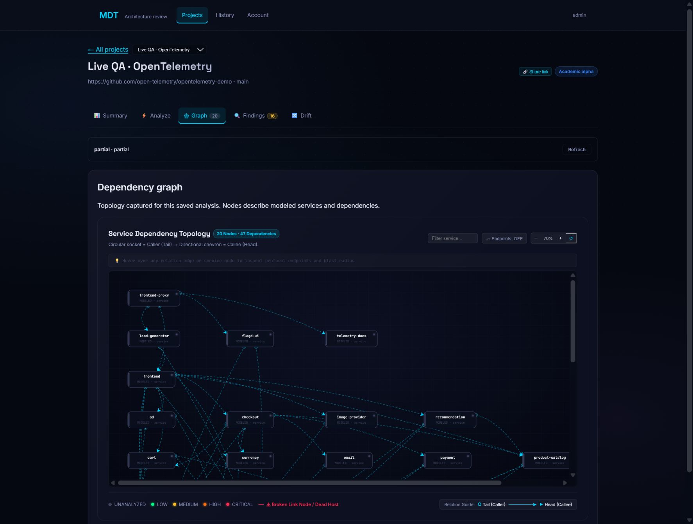

# Live website audit — 21 October 2026

Ten public repositories were submitted through the in-app Browser to the running local MDT website. Seven produced captured graphs and real parent-to-HEAD analyses; three returned insufficient architecture evidence. This validates the live import/analysis/display path and exposes limitations; it does not establish predictive accuracy.

## Results

All scores below are out of 100. Commit risk applies only to the pinned commit compared with its actual first parent. Debt describes the captured static graph. Higher debt means more detected structural debt. Every scored commit reported **insufficient evidence**, with evidence completeness 0; these scores must not be used as validated repository-quality rankings or incident probabilities.

| Repository | Nodes / edges | Commit risk | Debt |
| --- | ---: | ---: | ---: |
| [DietrichGebert/ponytail](https://github.com/DietrichGebert/ponytail/tree/09c434ab73ca43761c5d8b0c5d341926c2fba710) | Unavailable | Unavailable | Unavailable |
| [GoogleCloudPlatform/microservices-demo](https://github.com/GoogleCloudPlatform/microservices-demo/tree/38e7348eb289eb5b87c0c6e8cb19ced0449dc389) | 12 / 16 | 40 | 80.769 |
| [fastapi/full-stack-fastapi-template](https://github.com/fastapi/full-stack-fastapi-template/tree/b1125d8839482cb7bbae603ddc6d0081bf87532e) | 5 / 2 | 5 | 45 |
| [dockersamples/example-voting-app](https://github.com/dockersamples/example-voting-app/tree/63e9150ca17af4ed05880d4245e486481f73fcb4) | 6 / 5 | 40 | 52.174 |
| [microservices-demo/microservices-demo](https://github.com/microservices-demo/microservices-demo/tree/9dff06fae4981921caec6a62393a6ebfce4b3e3f) | 17 / 1 | 5 | 60 |
| [spring-petclinic/spring-petclinic-microservices](https://github.com/spring-petclinic/spring-petclinic-microservices/tree/1d76b00d683e86b62867a6bf59530f8ab301244f) | 11 / 13 | 5 | 72.152 |
| [open-telemetry/opentelemetry-demo](https://github.com/open-telemetry/opentelemetry-demo/tree/ba1757b3f197916640fff4f7c549b99e54835ab8) | 20 / 47 | 40 | 88.004 |
| [dotnet/eShop](https://github.com/dotnet/eShop/tree/913acea66708a59595351174cee9b29f37179d29) | Unavailable | Unavailable | Unavailable |
| [saleor/saleor-platform](https://github.com/saleor/saleor-platform/tree/ab6315bd59c58b4815175df4c679107ff9695be4) | 7 / 5 | 15 | 54.545 |
| [expressjs/express](https://github.com/expressjs/express/tree/0dee2c52c7c873498f8ed7d8ee4ddd0a04d3ada8) | Unavailable | Unavailable | Unavailable |

Exact head/base revisions, archive hashes, coverage, graphs, UI score cards and source fingerprints are saved in [JSON](benchmarks/live-website-2026-10-21.json); [CSV](benchmarks/live-website-2026-10-21.csv) provides the comparison table. Missing scores are null, never invented zeroes. The original benchmark remains a separate historical artifact.

## How it was checked

- Browser forms created projects, imported public repositories, submitted exact revisions, opened saved analysis summaries and rendered all seven supported graphs. Actual authenticated HTTP jobs and public GitHub retrieval were used; no transport mocks or prefilled repository outputs were substituted.
- Each rendered graph count and score card was checked against its exported saved result. Debt was recomputed from the exported snapshot using the same detector. This establishes consistency only; recomputation is not independent scientific ground truth.
- Independent upstream manifest inspection confirmed Voting's 6 declared nodes / 5 startup edges, Spring's 11 / 13 and OpenTelemetry's 20 declared nodes. Optional profiles are included in the modeled declaration, not claimed to be running containers. Source/manifest references are pinned in the results table.
- SVG paths were checked for nonfinite coordinates on all seven graphs. The 20-node graph also passed filtering/highlighting, node inspection, endpoint toggling and navigation into its own findings. Findings search returned the two circuit-breaker findings. No new console errors were recorded during the final interaction check; earlier development-module errors during local restarts were recovered by refreshing.
- Final backend suite: **336 passed**, including disposable PostgreSQL and transactional Neo4j integration checks. Frontend: **10 passed**, lint and production build passed. Existing validated dependency images were reused for local builds; this was not a fresh OS vulnerability audit.
- Additional API smoke attempts correctly returned HTTP 429 at the project quota, then at the daily 30-job quota after an exported QA fixture was removed. That extra smoke was not completed. Quotas were not raised or reset. Existing successful Browser jobs and automated tests remain the evidence for this run.
- Test repositories were read as source only; their code, dependencies and build scripts were not executed. The original MDT project and four-service fleet were preserved. Completed task-created fixtures were exported and some removed to respect the five-project limit. Spring, OpenTelemetry and Voting remain available locally for inspection.

## Fixes implemented

1. **Anonymous GitHub quota exhaustion:** added a bounded exact-SHA public archive fallback after anonymous REST rate limiting, with source hashes and transport evidence. Authenticated/private failures never fall back to public retrieval. Archives are not extracted or executed. Reads have size/file limits; metadata fetching has a deadline. Direct archive comparisons disclose that rename classification and merge-base comparisons are unavailable.
2. **False changed-file counts:** oversized files now have streamed content hashes, so unchanged large blobs do not become changes. Oversized source remains explicitly unavailable to parsers.
3. **Invented service values:** imports no longer assign baseline risk numbers, guessed ports/URLs or healthy status. Import summaries calculate static debt and state that commit risk has not been assessed. Legacy service routes preserve missing risk and measured zero instead of borrowing stale graph risk or assigning 90 to a broken link.
4. **Incomplete or duplicated topology:** declared databases/brokers are retained when their image is identifiable. Compose startup dependencies remain startup evidence, not invented HTTP routes. Deployment declarations prevent extra source folders/build templates from becoming undeclared services. Spring changed from 12 to 11 nodes; OpenTelemetry from 28 to 20. Google Boutique now retains Redis: 12 nodes / 16 edges.
5. **Unresolved ownership:** unknown changed-file ownership no longer marks every service affected. Missing ownership remains an evidence gap.
6. **Graph behavior tied to sample names:** removed preset service positions and named special-case curves. Generic layout derives positions and curves from topology/labels; renamed graphs and a 60-node cyclic/disconnected graph are covered by tests.
7. **Misleading job/navigation UI:** failed import status persists in the project directory; unsuccessful jobs do not display an apparently valid empty/old graph. Revision inputs have explicit accessible labels; default branch selection uses HEAD. A selected graph's Findings link now preserves its actual project and job instead of opening the demo. Missing endpoints display as unobserved rather than `/`. Unknown service health uses a neutral indicator instead of a green live-health dot; the legacy graph no longer invents an ONLINE label or port 8000.

No repository-specific expected output was added to production scoring/discovery. Existing heuristic weights, thresholds, drawing dimensions and resource limits remain configuration/algorithm constants; removing those would not make the analyzer more factual. Scores and topology come from captured inputs.

## Remaining accuracy work

- **Ponytail and Express:** no supported deployable service topology was discovered; neither received a graph score. **eShop:** .NET Aspire discovery is unsupported, so absence of a graph is a capability limitation, not evidence that the repository lacks services.
- **Sock Shop:** 17 nodes / 1 edge is explicitly incomplete. Deployment-only repositories often keep application source elsewhere. A high/low debt index on such partial topology is not a reliable overall architecture verdict.
- Extend gRPC/Go/Java/C# contracts, image-to-source ownership, Helm/Kustomize/Aspire interpretation and cross-repository relationships. Spring's current image-driven import has no supported application-source read coverage. Environment-interpolated image identities/ports can remain unresolved; no values were guessed for them.
- Separate startup relations, environment-reference candidates and verified API calls in future detector semantics and evaluation. Static circuit-breaker absence means evidence was not recorded, not proof that a running system has no resilience mechanism. Observed traffic remains unimplemented.
- Add independent labels, false-positive/false-negative evaluation, calibrated confidence and representative latency/load measurements before updating the paper's research claims. This ten-repository run provides failure cases and reproducible outputs, not an accuracy percentage.
- Final Browser verification was local, including the rebuilt Docker frontend's neutral health indicators. Production build and Nginx configuration checks passed. Public HTTPS hosting and installed browser/VS Code extension acceptance were outside this run.

No commit, push, GitHub write, public deployment or extension-store publication was performed.
