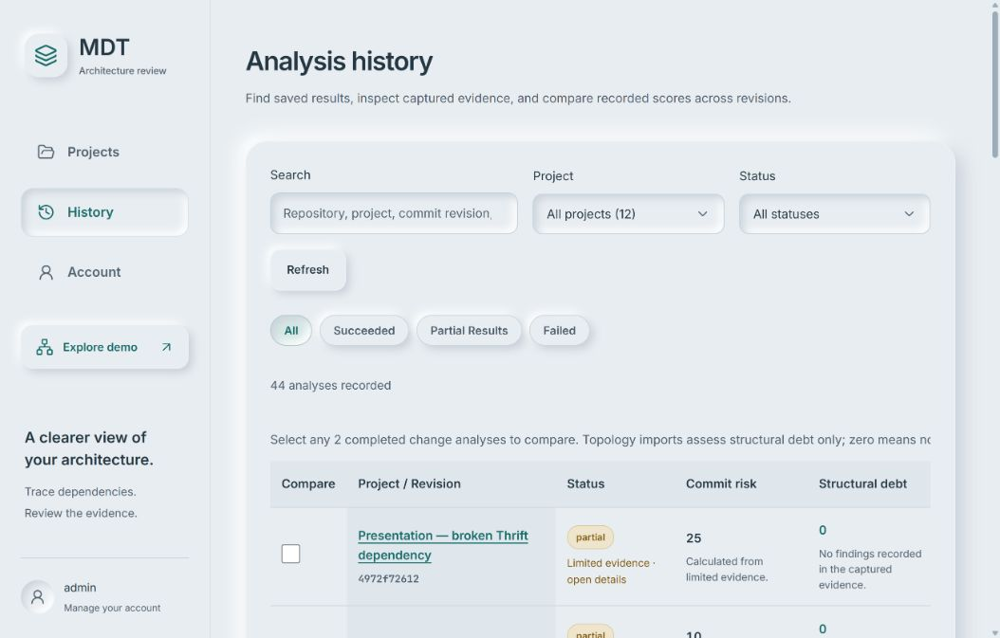
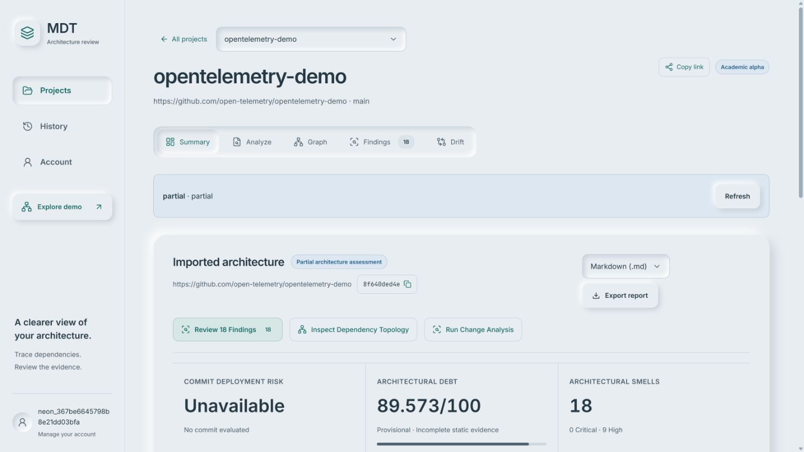

# Storage, authentication and service audit

Audit date: 28 October 2026 (Asia/Kolkata). This describes the local Docker stack and its connected Neon database. No commit, push, deployment to a remote host, deletion of user records, or removal of Docker volumes was performed.

## Where the data lives

The running backend uses **Neon PostgreSQL**, in the `mdt` schema:

| Data | Storage |
| --- | --- |
| Projects, captured topology, accounts, policies, baselines and finding reviews | `mdt.records` |
| Analysis/import history, result scores, warnings and completion state | `mdt.jobs` |
| Managed Google identity and provider sessions | Neon's separate `neon_auth` schema |
| Local administrator identity | Existing backend environment configuration; not a browser account |
| App bearer token and selected analysis in the browser | Tab-scoped `sessionStorage`; signing out clears this session state, not saved database records |

The local Docker volume `registry_data`, mounted at `/app/data`, also holds the legacy SQLite database, registry, fallback account file, local signing key and private backups. `neo4j_data` and `chroma_data` retain the local graph/history and retrieval index respectively. The host `backend/data/mdt.sqlite3` was a separate empty store at audit time.

Database records survive browser reloads and backend/container recreation. The app now retains history indefinitely by default (`JOB_RETENTION_DAYS=0`), also explicitly enforced in this local Compose configuration. Durability is not an off-site backup guarantee: deliberate deletion of the cloud database or Docker volumes is outside normal app retention.

## Missing history recovered without overwrites

The initial active cloud store contained 6 projects and 9 history rows. The Docker SQLite store still contained 6 older projects and 33 older history rows, all absent from the cloud store. They had not been deleted; they were left behind by the earlier database switch.

An append-only, transactional recovery added **37 records and 33 jobs**. It preserved original IDs, owners, timestamps, results, snapshots, a baseline and legacy analysis data. One identical quota record already existed and was left unchanged. The recovery script defaults to a dry run, rejects conflicting content, and never overwrites or deletes target records. Running it twice adds nothing the second time.

Two additional analyses completed during this audit. Final verification found **12 projects, 44 history entries and 18 captured snapshots**. Administrators can see all 44 history entries; the actual stored owners remain unchanged (43 under `admin`, 1 under the existing social account). Previously failed runs remain in history.

Original cloud records and original results were compared by SHA-256 before/after recovery. All matched. Every one of the 33 restored job rows also matched its original SQLite row exactly. Local `users.json`, `registry.json` and the persisted signing key were checked unchanged across the relevant backups/restart.

Private backup copies are in the ignored folder `scratch/preservation-20261028/`, with matching copies in `/app/data/audit-backups/`. They include consistent PostgreSQL logical exports, SQLite backups, manifests and local account/registry files. The final backup is `20261027-203224` (UTC timestamp, 28 October locally). Its compressed app-store SHA-256 is `2eed67f2bc4e1ef14bb6309b1f90750c1a30571329d64ce41aa21aa72b75b679`. These files include private authentication data and must remain outside Git. The logical backup contains all app records/jobs; it does not export or modify Neon's managed identity tables.

The local per-owner project quota was raised from 10 to 25 because the restored admin account already has 11 projects. This avoids requiring deletion to add another project. Hosted defaults were not changed.

## Why risk and debt differ

| History entry | Commit risk | Structural debt |
| --- | --- | --- |
| Topology import | Not assessed: no commit diff was analyzed | Computed from the captured topology and supported evidence |
| Completed change analysis | Calculated from the change and its impact | Recorded architectural findings |
| Queued/running job | Pending | Pending |
| Failed run without results | Unavailable | Unavailable |

Examples from the saved records: OpenTelemetry has risk `45` and debt `89.573`; Spring Petclinic has risk `25` and recorded debt `0`. Their topology-import entries correctly have no commit-risk score. A zero debt score means no findings were recorded in the captured evidence. Unsupported source syntax, missing contracts, startup-only relations and unmeasured runtime can still leave a run partial. Risk is an engineering indicator, not a calibrated incident probability.

History now separates **Commit risk** from **Structural debt**, explains missing/pending values, and retains score precision. Saved historical values were not recalculated or replaced with zero. The older diagnostics history component also no longer substitutes zero/LOW for an absent risk assessment.

## Bugs fixed

- Disabled the automatic 30-day history/snapshot/review deletion path by default.
- Replaced the ephemeral local JWT signing key with an atomic, persistent key in the existing volume. Production still requires an explicit secure key. Existing pre-fix sessions needed one sign-in when the old ephemeral key was replaced; subsequent restart/reload retained the new session.
- Removed OAuth authentication based solely on a client-supplied email/profile and the database session-timestamp join. The Neon SDK now exchanges the callback with the provider, obtains its session JWT, and the backend verifies signature, issuer, expiry and provider subject before loading a verified provider user.
- Bound social identity to the immutable provider subject. Verified existing social accounts retain their usernames, roles and data ownership; a matching email prefix cannot take over the seeded administrator. New identities remain viewers, and inactive accounts cannot sign in.
- Used the installed SDK's JWT helper after a real browser test found that this provider configuration does not support the plain Better Auth `/token` endpoint. Added a regression using the actual SDK, including rejection of opaque session tokens and profile-only login.
- Preserved sessions through temporary database/network failures. Authentication storage failures return 503 rather than falsely reporting an invalid token; frontend failures do not erase a valid tab session on a transient outage.
- Protected the previously exposed `/services` endpoints. Admin project/history access now resolves the actual record owner consistently, including filtered history, snapshots, reviews and previews. Privileges come from the stored role, not a username or a forged role claim.
- Anchored the main content beside the sidebar at wide/zoomed-out widths and constrained wide history tables to their own scroll region.
- Fixed dropdown pointer selection inside labels: label activation no longer reopens the button after a choice. Keyboard selection, pointer selection, filters and restored choices were checked in the browser.
- Corrected diagnostics that equated a configured AI key with provider readiness, advertised an unimplemented model fallback chain, and displayed an active Chroma heartbeat while disconnected.
- Updated SDK transitive dependencies to patched versions. The frontend dependency audit reports no vulnerabilities at audit time.

## Verification and limits

- Full isolated backend suite: **459 passed, 13 optional/environment-dependent tests skipped**. Ten of those PostgreSQL tests were separately executed successfully. The suite covers ownership, authentication, imports, source/patch extraction, jobs, cancellation/leases, snapshots, baselines, drift, policies, reviews, graph previews, webhook validation and CLI hooks. Tests ran against copied files and isolated databases, without access to the live network/store.
- PostgreSQL suite: **10 passed**, including concurrency, owner isolation, rollback, immutable snapshots, append-only recovery and concurrent identity binding. It used a separate internal Docker network and disposable test database, never Neon. That test database was stopped afterward.
- Frontend suite: **36 passed**, plus lint and production Docker build. This includes score precision/missing values, graph geometry/relations, previews, session rejection and the real SDK token contract.
- Live API/service audit: **213 checks passed** against the then-current 43-entry history. Every listed project, history result, available saved snapshot and reviews endpoint was checked, including other-owner admin access. One later completed analysis brought the total to 44 and was separately inspected.
- All eight local Compose services were running. Backend readiness, PostgreSQL, Neo4j, Chroma, frontend proxy and all four demo-service health endpoints passed.
- Browser checks: local admin sign-in, renewal, reload after backend restart; full Google OAuth return to MDT, viewer role, sign-out and reload without automatic re-login; dropdown filtering and comparison of restored OpenTelemetry results. No existing account was promoted or renamed.
- LLM provider: its model catalogue returned HTTP 200 and included the configured model. Synthetic generation probes returned a timeout and HTTP 503. The app's deterministic fallback was verified live, returning a nonempty explanation within its bounded timeout. Remote generation availability remains a provider-side limitation, not a passing result. Saved/owned project analyses intentionally run deterministically without sending source to the operator's model provider.
- GitHub is currently unauthenticated in this local configuration. Public repository imports are supported; authenticated private-repository access and external webhook delivery were not claimed as live-verified.

## Relevant implementation

- `backend/core/store.py`, `backend/core/config.py`, `backend/core/local_secrets.py`: persistence and retention.
- `backend/core/neon_auth.py`, `backend/api/auth.py`, `backend/core/auth.py`: verified identity, roles, sessions and outage behavior.
- `backend/api/projects.py`: consistent authorized access to saved resources.
- `scripts/restore_legacy_store.py`: dry-run-first, append-only SQLite recovery.
- `frontend/src/utils/neonAuth.js`, `frontend/src/context/AuthContext.jsx`: SDK callback and application session handling.
- `frontend/src/components/ProjectHistory.jsx`, `frontend/src/components/CustomSelect.jsx`, `frontend/src/Neumorphic.css`: score explanations, dropdowns and layout.

Provider verification follows [Neon's JWT verification guidance](https://neon.com/docs/compute/functions/authentication) and the [installed Neon SDK source contract](https://github.com/neondatabase/neon-js/tree/main/packages/auth).

## Follow-up: newer account project access

The workspace owner subsequently reported that the newer social account could not create a project. Its sign-in was valid, but it had the default read-only `viewer` role while the UI offered project creation.

The requested account was explicitly granted `analyst` access for its own projects, with an `account_access_change` audit record. Its immutable provider identity and existing account fields were retained. It was not granted administrator access. A fresh private backup was taken before this change (`20261028-015823`, UTC).

New self-service accounts now receive analyst access only in the local profile when self-signup is enabled. Hosted/invite-only defaults remain read-only until explicitly provisioned. Existing read-only accounts are not automatically promoted. The frontend now hides creation controls for read-only accounts and explains the restriction. Authentication continues to use the durable current role rather than trusting role claims in an older token.

Verification: 466 backend tests passed (13 optional/environment-dependent tests skipped), 42 frontend tests passed, and lint/production builds passed. New tests cover own-project creation and analysis, cross-account isolation, forbidden admin actions, hosted/read-only defaults, and the rendered creation form.

The real newer account completed Google sign-in with its analyst role. Its requested OpenTelemetry repository was created and imported successfully under that account: project `3add715f663b4c95be5e93b780de8295`, import `ef7944333d0249efb4711b7ab2b7263f`. The result retained 18 findings and debt `89.573`, with partial-evidence coverage clearly disclosed. This added one project/history entry and did not replace any existing records.

Post-change backup `20261028-020906` contains 13 projects and 45 history entries. Verification against the preceding backup confirmed that all prior projects, jobs and other records are identical; only the requested account's role changed from viewer to analyst. Its other identity fields are identical.

